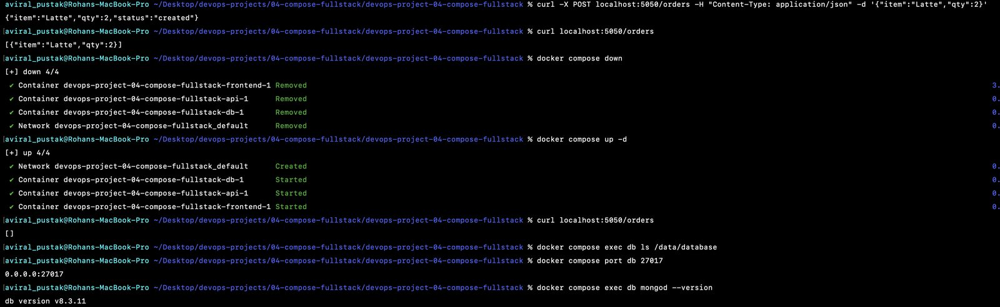
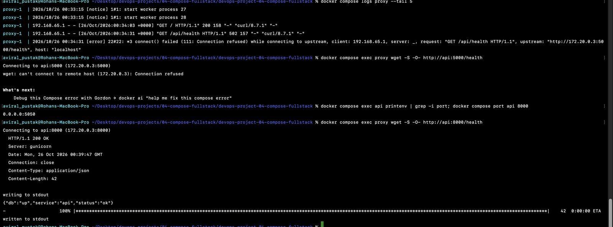
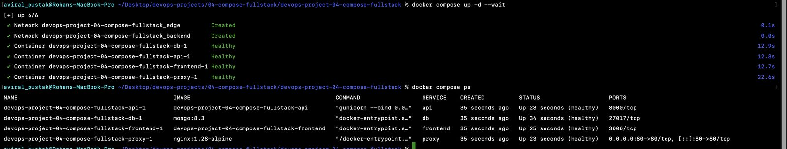

# Project 04: Multi-Service Stack with Docker Compose

**Real-World DevOps Projects** · Part 4 of 20 · Rohan Aviral

> **Ticket DEV-220 from Neha (Developer).** New developers take two days to get the app running locally. Can you give us one command that brings up frontend, API, database and a proxy? Also my compose file is broken, I'm attaching it.

This repo is **BrewCart**, a small coffee-ordering app, running as a production-like local stack: an **Nginx** reverse proxy in front, an **Express** frontend, a **Flask** API and **MongoDB**. Everything starts with `make up`.

📄 Full step-by-step write-up with screenshots: **[Project_04_Compose_Fullstack.pdf](https://github.com/Aviral-Rohan/devops-project-04-compose-fullstack/releases/download/v1.0.0/Project_04_Compose_Fullstack.pdf)** (attached to the v1.0.0 release)
🏷️ Release: [v1.0.0: One-command local stack](https://github.com/Aviral-Rohan/devops-project-04-compose-fullstack/releases/tag/v1.0.0)
⬅️ Previous: [Project 03, Production-Ready Docker Images](https://github.com/Aviral-Rohan/devops-project-03-docker-production-images) · ➡️ Next: Project 05

---

## In plain words

Running BrewCart used to mean starting four programs by hand, in the right order, with the right settings. **Docker Compose** is one recipe card for the whole kitchen: which containers to run, how they talk, where data is kept, and in what order they start.

- **One front door.** Nginx listens on port 80 and sends `/` to the website and `/api/...` to the API. Nothing else is reachable from outside.
- **Two rooms.** The proxy, frontend and API share a front room (`edge`). The API and database share a locked back room (`backend`). The proxy can't even see the database.
- **Data that stays.** Orders live in a named volume, so they survive `docker compose down` and `up`.
- **Ready before open.** Each service waits until the one it needs reports *healthy*: database, then API, then frontend, then proxy.
- **No passwords in Git.** Settings live in `.env` (ignored). `.env.example` shows new developers what to fill in.

---

## Developer onboarding

### Prerequisites

- Docker Desktop (includes Docker Compose v2)
- `make` and `curl` (built into macOS and most Linux distributions)

### Start

```bash
git clone https://github.com/Aviral-Rohan/devops-project-04-compose-fullstack.git
cd devops-project-04-compose-fullstack
make up          # creates .env from .env.example on first run, builds, waits until healthy
make test        # smoke test through the proxy
```

Open **http://localhost** for the menu and **http://localhost/api/menu** for the API.

On first run, `make up` copies `.env.example` to `.env`. Change `MONGO_PASSWORD` in `.env` **before** the first start: MongoDB only creates its admin user when the data volume is empty (see Troubleshooting).

### Everyday commands

| Command | What it does |
|---|---|
| `make up` | Build images and start everything; returns when all services are healthy |
| `make down` | Stop and remove containers and networks. **Data is kept.** |
| `make logs` | Follow the logs of all services (Ctrl+C to stop) |
| `make ps` | Status and health of each service |
| `make test` | Check proxy, frontend, API and database through port 80 |
| `make help` | List the targets |

### API endpoints (through the proxy)

| Method | Path | Returns |
|---|---|---|
| GET | `/api/health` | `{"status":"ok","db":"up"}`, or `503` if the database is down |
| GET | `/api/menu` | The menu, read from MongoDB (seeded on first use) |
| GET | `/api/orders` | All orders |
| POST | `/api/orders` | Creates an order, e.g. `{"item":"Latte","qty":2}` |

```bash
curl -X POST localhost/api/orders -H "Content-Type: application/json" -d '{"item":"Latte","qty":2}'
```

---

## Architecture

```
                 host :80
                    │
              ┌─────▼─────┐
              │   proxy   │  nginx:1.28-alpine
              └──┬─────┬──┘
        /        │     │  /api/  (prefix stripped)
   ┌─────────────▼┐   ┌▼──────────────┐
   │   frontend   │──▶│      api      │  gunicorn :8000
   │  node :3000  │   │  Flask        │
   └──────────────┘   └───────┬───────┘
 ─ ─ ─ ─ edge network ─ ─ ─ ─ ┼ ─ ─ ─ ─ ─ ─ ─ ─ ─
        backend network       │  (internal: true)
                      ┌───────▼───────┐
                      │      db       │  mongo:8.3
                      │  volume:      │
                      │  mongo-data   │
                      └───────────────┘
```

| Service | Image | Networks | Published | Health check |
|---|---|---|---|---|
| proxy | `nginx:1.28-alpine` | edge | `${PROXY_PORT:-80}:80` | `wget /healthz` |
| frontend | built from `./frontend` | edge | no | `fetch /health` (from the Dockerfile) |
| api | built from `./api` | edge, backend | no | `urllib /health`, which also pings MongoDB |
| db | `mongo:8.3` | backend | no | `mongosh` `ping` |

Start-up order is enforced with `depends_on: condition: service_healthy`:

```
db healthy → api healthy → frontend healthy → proxy
```

---

## The five mistakes in Neha's compose file

Full details: [`docs/compose-fixes.md`](docs/compose-fixes.md)

| # | Mistake | Symptom | Fix |
|---|---|---|---|
| 1 | `depends_on: mongo` (the service is `db`) | `depends on undefined service "mongo"` | `depends_on: db` |
| 2 | `MONGO_URL` used `localhost` | API `503`, `"db":"down"` | `@db:27017`: inside a container, localhost is the container itself |
| 3 | Volume at `/data/database` | Orders gone after `down` and `up` | `/data/db`, where MongoDB writes |
| 4 | DB published on `27017` with the password in the file | Database reachable from outside | Port removed; credentials moved to `.env` |
| 5 | `mongo:latest` | Different versions on different machines | Pinned to `mongo:8.3` |



## The twist: 502 through the proxy, 200 directly

`curl localhost/api/health` returned **502 Bad Gateway**, while the API answered **200** on its published port. Instead of guessing, I debugged from inside the Nginx container:

```bash
docker compose logs proxy --tail 5
#  connect() failed (111: Connection refused) ... upstream: "http://172.20.0.3:5000/health"
docker compose exec proxy wget -S -O- http://api:5000/health   # Connection refused
docker compose exec proxy wget -S -O- http://api:8000/health   # 200 OK
```

**Root cause:** `nginx.conf` pointed at port 5000, taken from the out-of-date README. The API image listens on **8000** (DEV-214). Containers talk to each other on the **container port**; the published host port (`5050`) is only for the host. The fix was one line (`proxy_pass http://api:8000/;`), checked with `nginx -t` and applied with `nginx -s reload`, without downtime.



## Proof

| Check | Result |
|---|---|
| `docker compose up -d --wait` | db → api → frontend → proxy, all `(healthy)` |
| Orders after `down` and `up` | Still there (named volume at `/data/db`) |
| `docker compose exec proxy wget http://db:27017` | `bad address 'db'`: the proxy can't see the database |
| `docker compose exec api python -c "...gethostbyname('db')"` | `172.21.0.2`: the API can |
| `curl localhost:5050/health` | `000`: no side doors, port 80 only |
| `docker compose stop db` | API turns `unhealthy`, `/api/health` → `503`; back to healthy after `start db` |
| `.env` hidden | `required variable MONGO_USER is missing a value` |



---

## Troubleshooting

| Symptom | Cause | Fix |
|---|---|---|
| `502 Bad Gateway` on `/api/...` | Nginx can't connect to the API: wrong port, or the API isn't running | `docker compose logs proxy`, then `docker compose exec proxy wget -O- http://api:8000/health` |
| `ports are not available ... :80` | Something else on your machine uses port 80 | Set `PROXY_PORT=8080` in `.env` and use http://localhost:8080 |
| `required variable MONGO_USER is missing a value` | No `.env` | `cp .env.example .env` (or just `make up`) |
| API unhealthy and `/api/health` returns `503` although `db` is healthy | `MONGO_PASSWORD` changed after the volume was created; Mongo only creates the user on first start | Use the original password, or reset local data: `docker compose down -v` (**deletes all data**) |
| Orders vanish after a restart | Someone ran `docker compose down -v` | Only use `-v` when you mean to wipe data |
| macOS: port 5000 busy | AirPlay Receiver | Not used any more: only port 80 is published |

## What's inside

```
devops-project-04-compose-fullstack/
├── docker-compose.yml        # 4 services, 2 networks, 1 named volume, healthchecks, ordered start-up
├── nginx/nginx.conf          # / → frontend:3000, /api/ → api:8000, /healthz
├── Makefile                  # up, down, logs, ps, test, help
├── .env.example              # settings template (.env is git-ignored)
├── api/                      # Flask + pymongo, gunicorn :8000 (hardened image from Project 03)
├── frontend/                 # Express :3000 (hardened image from Project 03)
└── docs/
    ├── compose-fixes.md      # the five mistakes, symptoms and fixes
    ├── compose-cheatsheet.md # every command used in this project
    └── screenshots/
```

## Problems I hit

| Problem | Cause | Fix |
|---|---|---|
| Couldn't set required approvals to 0 | The dropdown starts at 1 | Untick "Require approvals" and keep "Require a pull request" on |
| Port 5000 already in use | macOS AirPlay | Published the API on 5050 during debugging |
| `did not find expected key` at `L1.C1–L11.C3` | `proxy:` indented 4 spaces instead of 2 | Re-indented; Shift+Tab in VS Code |
| Forgot to pin `mongo:latest` in the first commit | Missed one line | Pinned to `mongo:8.3` (the version the data was created with) and `git commit --amend` before pushing |
| 502 through Nginx | Proxy pointed at port 5000, API listens on 8000 | Debugged from inside the proxy; `proxy_pass http://api:8000/` |
| Old `_default` network left behind | Compose doesn't remove networks a project no longer defines | `docker network rm ..._default` |

## What I learned

- Inside a container, `localhost` is that container. Services find each other by **service name** on a shared network.
- `ports: "HOST:CONTAINER"`: other containers always use the **container** port.
- A 502 means the proxy is up but can't reach the upstream. Test from **inside** the proxy container before changing anything.
- `depends_on` alone only orders start-up; `condition: service_healthy` waits for **readiness**.
- Named volumes survive `down`; `down -v` deletes them. Mount them where the app actually writes.
- Put only the proxy on a published port. Keep the database on an `internal` network.
- `${VAR:?message}` turns a missing secret into a clear error instead of an empty password.
- Pin every image, including the database: data files can't always be opened by an older version.

## License

MIT. BrewCart and the team members named here are fictional, for training.
